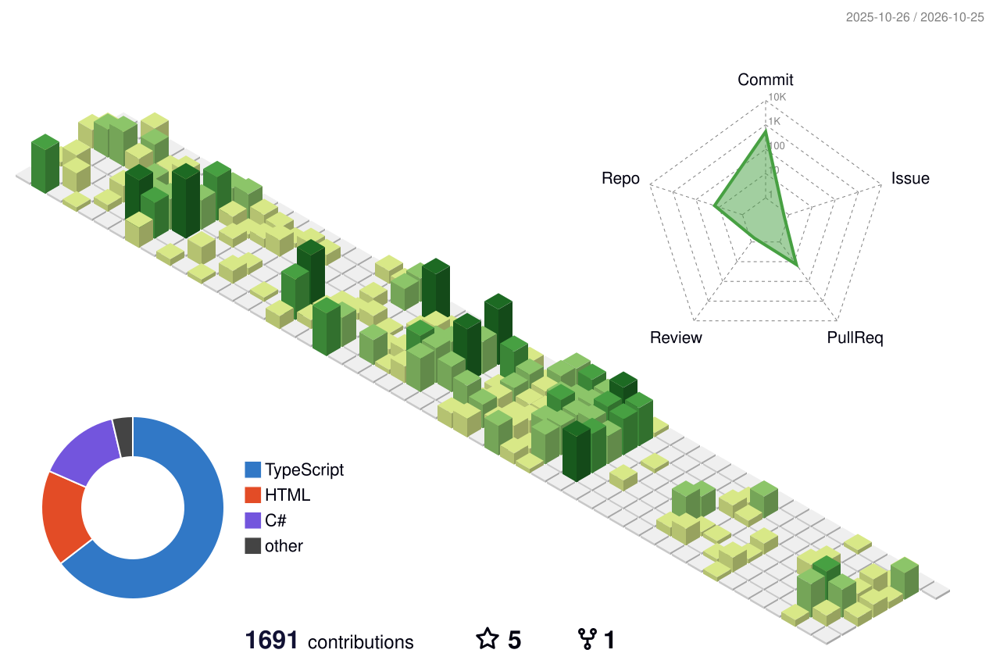

<h1 align="center">
  
</h1>

  

  

---

## About Me

- 👋 Hi, I'm **@susanforme**.
- 💻 Interested in software development and technology.
- 🌱 Always learning and exploring new things.
- 🚀 Building projects and sharing them on GitHub.

---

## Contributions

  

  <picture>
    <source
      media="(prefers-color-scheme: dark)"
      srcset="https://raw.githubusercontent.com/susanforme/susanforme/output/github-snake-dark.svg"
    />
    <source
      media="(prefers-color-scheme: light)"
      srcset="https://raw.githubusercontent.com/susanforme/susanforme/output/github-snake.svg"
    />
    
  </picture>

